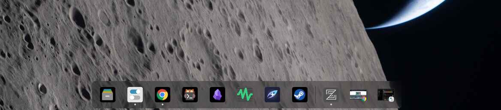

# Adaptive Dock Icons

A COSMIC™ dock applet with icons that adapt to your theme.




## Install

Requires Rust 1.93+, `just`, and COSMIC development libraries.

```sh
just install
```

In **COSMIC Settings → Desktop → Dock → Applets**, replace **App Tray** with **Adaptive Dock Icons**.

## Icon size

Set the icon edge in logical pixels in
`~/.config/cosmic/io.github.motixo.AdaptiveDockIcons/v1/icon_size`
(or under `$XDG_CONFIG_HOME` if set). For example:

```sh
config_dir="${XDG_CONFIG_HOME:-$HOME/.config}/cosmic/io.github.motixo.AdaptiveDockIcons/v1"
mkdir -p "$config_dir"
printf '32\n' > "$config_dir/icon_size"
```

Changes apply live. Use `0` for the dock's default icon size. Only the icons and
their surrounding padding change; dock dimensions and button spacing stay the
same. Large values are limited to the available space, and small values to the
width of the running-window indicator (8 or 12 pixels). To start with the default
configuration, copy [resources/icon_size](resources/icon_size) to that path.

## Logo size inside frames

To reduce the empty space around a logo inside an applet-added frame, set
`logo_scale` in the same configuration directory:

```sh
config_dir="${XDG_CONFIG_HOME:-$HOME/.config}/cosmic/io.github.motixo.AdaptiveDockIcons/v1"
mkdir -p "$config_dir"
printf '125\n' > "$config_dir/logo_scale"
```

The value is a percentage of the default logo size: `100` keeps the original
appearance, `115` or `125` enlarges the logo and reduces padding, and `80` makes
the logo smaller. Values below `1` are treated as `1`. Changes apply live; the
frame, dock dimensions, and button spacing stay the same, independently of
`icon_size`. Missing or invalid settings use `100`.

Enlargement is capped at the frame's rounded corners so the artwork stays
inside. Square frames allow up to `125`; slightly rounded frames allow about
`116`, and circular frames already use their largest safe fit at `100`.
This setting affects frames added by the applet; spacing embedded in an
icon's original artwork is unchanged. A default example is provided in
[resources/logo_scale](resources/logo_scale).

[GPL-3.0-only](LICENSE) · Based on COSMIC App List ([NOTICE](NOTICE)).
